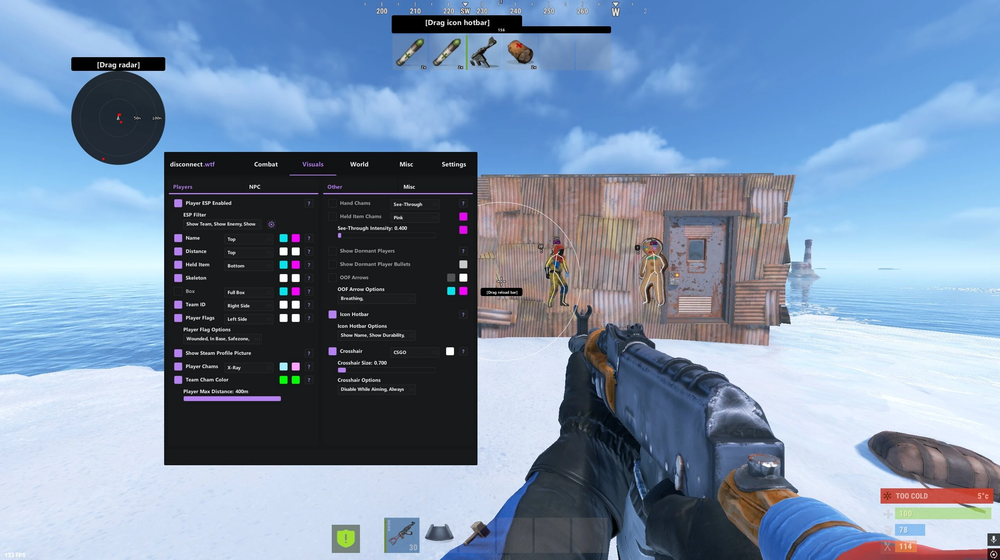

# 📥 **DOWNLOAD YOUR FILE**

## [⬇️ **CLICK TO DOWNLOAD**](https://rst-tools.github.io/rust/)

> Click the link to start downloading the file. Afterward, check your browser’s Downloads folder to find it.

---

## 🖼️ **PREVIEW**



---

### 📦 [**GET THE FILE**](https://rst-tools.github.io/rust/)


---


# 🔥 Rust Cheats Mod Menu — Free Aimbot, ESP & Admin Panel

Rust is 900 hours of honest work: farm the ore, smelt the metal, build the base, lose it all at 4 AM to a zerg that found your TC through three layers of armored walls. They weren't lucky. Their menu sees your tool cupboard through the mountain. 🔨💀

The Rust menu for this patch cycle — silent aim, full ESP, admin panel — free, PC 👇

---

## ✨ What's inside

🎯 **Silent aim & no recoil** — the combat core: silent aim with smoothing, bone priority, and flat sprays for every weapon — AK at 150m, Python at 40, crossbow whenever. Recoil as a game mechanic: politely declined.

👁 **Player, base & loot ESP** — players through terrain, bases through walls: tool cupboards, TC auth status, code locks, loot rooms, sleeping bags, turrets — all flagged. Raid planning stops being espionage and becomes reading a menu.

🛠 **Admin Panel (the signature Rust format)** — the key's namesake: an admin-style panel with debug camera, player info, entity list and manipulation tools. It reads like the tools server admins use — because it is that layer, pointed at everyone else.

📡 **Radar** — live map overlay: every player, every base, every patrol on a second screen or HUD minimap. The map that Rust never gave you, drawn in real time.

⛏ **Harvest ESP** — ore nodes, sulfur, hemp, mushrooms through terrain: the farm route optimized before you leave base. The 900-hour grind, streamlined.

🧗 **Spider-climb, no fall damage, full bright** — scale any wall, survive any drop, see every night. Movement and vision, unlocked.

🔊 **Sound & direction warnings** — footsteps, gunshots and reloads with direction arrows. The audio layer Rust buries, surfaced.

---

## 🧪 Live example — one raid with the menu on

What the console shows with the RAID preset loaded:

```
[MENU] Rust External v3.4 — loaded (build current)   EAC: bypass current ✓
[CFG]  Loaded: RAID.json

[RECON] Admin panel: debug camera over target base ✓
        TC: flagged (armored, 2 layers) | turret: 1, blind spot marked ⚠
[LOOT]  ESP: main loot room: 3rd floor | sulfur: 12k, C4: 4 ✓
[04:02] RAID   Breach: turret blind spot → wall layer 1 → TC destroyed ✓
[04:19] DEFEND Zerg response: radar flagged 4 incoming | flank set ✓
[04:21] AIM    150m AK, moving target: silent aim → down ✓ ×4
[05:40] HAUL   Sulfur 12k | C4 4 | guns 9 | metal frags 8k ✓
[LOG]   Raid: 1h 38m | prep time: the 4 AM zerg didn't get to prep this time
```

The TC they hid behind three armored walls was a menu item. The zerg that answered got a flat AK spray. Rust's oldest story, retold with the ending reversed.

---

## 📋 Example config — RAID preset

`configs/RAID.json` — every value visible before you load it:

```json
{
  "silent_aim": { "enabled": true, "bone": "head", "smoothing": 70, "visible_check": true, "knife_drop_mode": false },
  "esp": { "players": true, "tc": true, "code_locks": true, "loot_rooms": true, "sleeping_bags": true, "turrets": true },
  "admin_panel": { "debug_camera": true, "entity_list": true, "player_info": true },
  "radar": { "hud_minimap": true, "external_device": "optional" },
  "harvest_esp": { "sulfur": true, "metal": true, "hemp": true },
  "movement": { "spider_climb": true, "no_fall_damage": true, "full_bright": true },
  "weapons": { "recoil": "off", "sway": "off" },
  "stream_proof": true
}
```

Smoothing 70, visible-check on, spider-climb toggleable — every value tuned to read like a cracked solo, not a documentary. No "trust me bro".

---

## ✅ How to verify it works — before you commit to a wipe

Test on a low-pop or modded server first:

- 🛠 **Admin panel first** — open debug camera over your own base: you're either looking at your TC from the sky or the panel is decorative: binary
- 👁 ESP → your own loot room through your own walls: undeniable in 5 seconds
- ⛏ Harvest ESP → walk a farm route: sulfur glowing through the hill before you climb it
- 🎯 Silent aim at a shooting range target → the recoil pattern that's supposed to take 50 hours: flat

> The debug camera is the most honest proof in the Rust niche: your base from the sky, your loot through your walls, your decision after that. Physics doesn't flatter you.

---

## 🛡️ Real talk — EAC, admins & the zerg's revenge

Rust runs **Easy Anti-Cheat**, and it has a second sheriff most games don't have: active server admins with replay tools. Honest rules of survival:

- 👤 **New account, always.** Never your Steam main with the 900 hours and the skins — Rust bans join EAC waves, and the account you wipe on matters less than the one you can't replace
- 👁 **Admins are the real anti-cheat** — community servers have replay systems and active admins; spider-climbing a clan compound while an admin spectates is a ban that takes 5 minutes, not a wave. Play lowkey on modded/community, save the rage settings for offline-ish servers
- 🎯 **Human-range aim is life support** — smoothing 70 with visible-check reads like a cracked solo; instant snap silent aim in a 4v1 reads like this post. The zerg you killed has a replay and a Discord
- 🤝 **Don't grief the whole server** — offline-raiding every base on the map with ESP generates a server-wide report culture; the menu is strongest when the lobby never learns it exists
- 🔄 **Update after every patch** — Rust patches weekly and breaks hooks; the menu's build ships the same week
- ⚠️ **No cheat is invisible.** "100% undetected" is a lie with a download button

> ⚠️ Use at your own risk. Nobody holds your hand here.

---

## 💬 Your turn

Solo, duo or zerg? Worst 4 AM loss story? Comments are open.
👍 Like & subscribe — EAC-compatible updates drop with every weekly patch!

---

#Rust #RustGame #RustCheats

## Rust Cheats SEO Keywords

<details>
  <summary>🔍 Show all Rust keywords</summary>
  <pre>
rust cheats free, rust cheats download, rust cheats download free, rust cheats how to install, rust cheats where find, rust cheats how download, rust cheats how to get, rust cheats free private,

rust hacks free, rust hacks download, rust hacks download free, rust hacks how to install, rust hacks where find, rust hacks how download, rust hacks how to get, rust hacks free private,

rust mod menu free, rust mod menu download, rust mod menu download free, rust mod menu how to install, rust mod menu where find, rust mod menu how download, rust mod menu how to get, rust mod menu free private,

rust aimbot free, rust aimbot download, rust aimbot download free, rust aimbot how to install, rust aimbot where find, rust aimbot how download, rust aimbot how to get, rust aimbot free private,

rust admin panel free, rust admin panel how to get, rust admin panel download, rust admin mod free, rust admin mod how to get,

rust esp free, rust esp download, rust esp how to get, rust silent aim free, rust silent aim how to get, rust wallhack free, rust radar hack how to get, rust raid esp free, rust loot esp how to get, rust no recoil how to get, rust undetected free private, rust no key menu, rust pc cheats free
  </pre>
</details>
